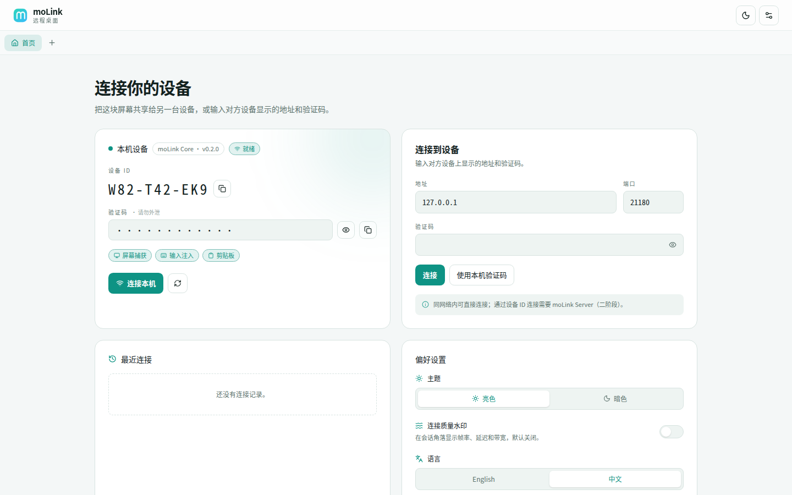
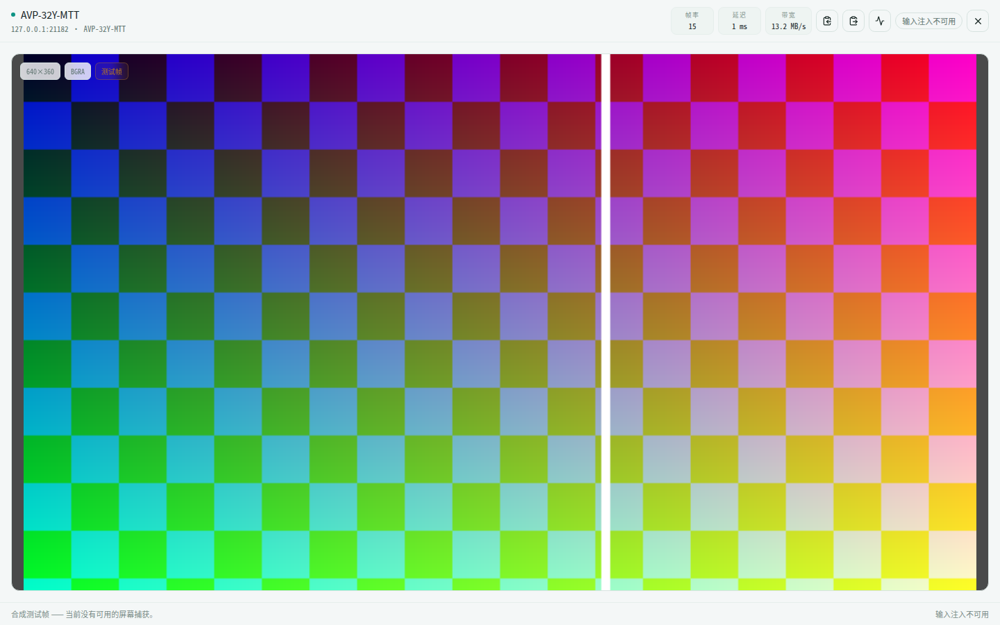
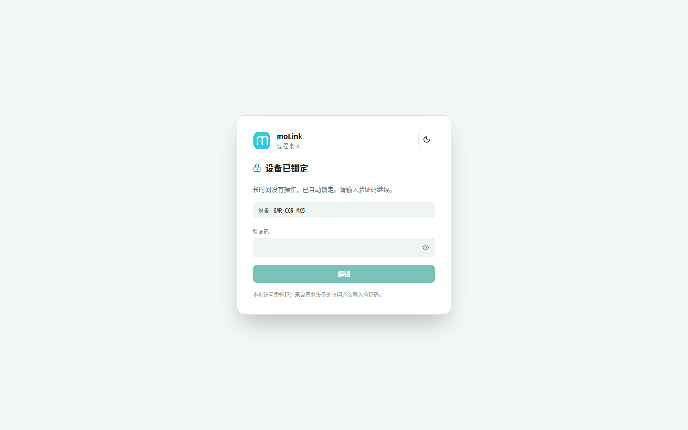

# moLink

跨平台远程桌面。Web 优先，一套后台 + 浏览器壳层，桌面端直连，移动端经服务端中转。

> 版本 0.9.14 · MIT · 协议版本 1





> 会话页截图为合成测试帧演示；接入真实屏幕后画面即为对端桌面。暗色主题见
> [home-dark.png](docs/screenshots/home-dark.png)。

## 当前状态

一阶段（桌面直连）已完整实现：Linux（X11）、Windows（DXGI）、macOS（CoreGraphics）各有抓屏、输入注入、光标与剪贴板后端，三个平台使用系统 WebView 的独立壳层。界面采用“设备页 + 多会话”布局，支持亮/暗主题、无边框圆角窗口、托盘与连接质量水印。

| 能力 | 状态 |
|---|---|
| `molink-core` HTTP/WS 后台、令牌鉴权、默认拒绝非回环连接（安全设置可热切换） | ✅ |
| MOLK 瓦片帧包（C++ + TS）、增量帧、关键帧恢复 | ✅ 36 项协议测试 |
| Linux 抓屏/输入/光标/剪贴板 | ✅ X11 + XShm + XDamage · XTEST · XFixes |
| Windows 抓屏/输入/剪贴板 | ✅ DXGI Desktop Duplication（Win8+）· GDI BitBlt 回退（Win7 x86）· SendInput · CF_UNICODETEXT |
| Windows 7 x86 客户端 | ✅ GDI 采集 + SendInput 内核、Win32/WebView2 外壳、浏览器 UI；需 Win7 SP1，原生外壳需 WebView2 Runtime 109 |
| macOS 抓屏/输入/剪贴板 | ✅ CoreGraphics · CGEvent · NSPasteboard |
| 设备 ID / 验证码（持久化，默认隐藏） | ✅ 令牌保存在配置目录 |
| 本机免验证 / 远程验证码登录 | ✅ 回环免验证；非本机必须验证 |
| 远程一键控制核心所在主机 | ✅ 验证后点击即可 |
| 空闲自动锁定（默认 60 秒） | ✅ 仅非本机（远程浏览器）无操作时锁定；本机壳层/浏览器不锁定 |
| 首次连接独立窗口、后续连接 Tab、标签拖出 | ✅ 三个平台的原生多窗口 |
| 亮/暗主题、无边框圆角、自绘标题栏、关闭到托盘 | ✅ Linux/Windows；macOS 使用原生标题栏 |
| 连接质量水印（默认关闭） | ✅ |
| 瓦片 zlib 压缩（codec 5） | ✅ 真实桌面实测 94 → 7.4 Mbps |
| Linux Wayland / PipeWire | ⏳ 回退合成帧 |
| H.264 / AV1 + WebCodecs | ⏳ |
| 设备目录 / 按 ID 连接（moLink Server） | ✅ 注册/心跳/在线状态/HTTPS；桌面端已接入 |
| 中继 / TURN、WebRTC/P2P、UDP 直连、移动端 | ⏳ 二阶段后续 |

## P2P / ICE（按设备 ID 连接）

浏览器不能自己开 UDP 或跑 ICE，所以“按 ID 连接”由本机核心代理：

1. 前端连接本机的 `ws://<本机核心>/ws/connect?target=<设备ID>`（本机壳层和远端浏览器
   都是同一个核心）。核心**先**通过目录的 `WS /v1/relay` 建立中继会话（秒开），同时后台
   继续 ICE 打洞；成功后自动切换到 P2P，失败则保持中继。连接页可勾选“强制中继”跳过打洞。
2. 本机核心通过目录的 `/v1/connect*` 信令与被叫交换 ICE offer/answer；双方核心用
   libjuice 的 external-socket 模式，在各自的 `uvcpp_udp` 上打洞（libjuice 不建
   socket、不建线程，`uvcpp_timer` 驱动重传/保活）。
3. ICE 完成后，浏览器 WebSocket 与 ICE/UDP 会话做透明桥接；被叫端用与
   `/ws/session` 相同的 `session_controller` 处理 hello、验证码、帧和输入。
4. ICE 失败时本地核心关闭代理连接，前端自动回退到目录返回地址的直连 WebSocket。

UDP 数据报按 1200 字节分片/重组（tag + kind + id + index + count），因此大关键帧
可以走 UDP。STUN 通过 `MOLINK_STUN_HOST` / `MOLINK_STUN_PORT` 配置；未配置时仅使用
主机候选，适合局域网/同一 NAT。`MOLINK_P2P_PORT` 让 ICE 套接字绑定固定本地端口
（默认临时端口），便于防火墙放行对端的连通性检查。TURN 兜底尚未在客户端接入，可使用
coturn 或 libjuice 自带的 `juice_server`（见服务端仓库 `docs/p2p-relay.md`）。

## 架构

```
┌──────────────┐        ┌────────────────────────────────┐
│ 桌面壳层     │        │ molink-core (C++/libuvcpp)     │
│ React 前端   │◄──────►│ HTTP/WS :28418（默认拒绝非回环）│
└──────────────┘        │ 捕获/编码 · 输入注入 · UDP     │
                        └────────────────────────────────┘
```

- **molink-core**：C++20 + libuvcpp 后台。负责 HTTP/WS 接口、三平台捕获/注入/剪贴板、瓦片帧编码与会话管理。
- **传输抽象**：`transport/session_transport.h` 定义文本/二进制/关闭/对端信息接口；`session_controller` 只依赖该接口，WebSocket 是第一个实现。后续接 TCP/QUIC 时新增一个 transport 实现和监听器即可，会话状态机、鉴权、帧回放、输入和剪贴板逻辑都不用改。
- **frontend/**：React 19 + TypeScript + Vite + Tailwind 4 + Zustand + react-i18next。
- **shell/**：三个平台各自的原生壳层（Linux GTK/WebKitGTK、Windows WebView2、macOS WKWebView），启动并监管 `molink-core`，加载核心托管的前端。
- **moLink Server**：设备目录与管理服务位于独立仓库
  [Antruly/molink-server](https://github.com/Antruly/molink-server)（当前 0.2.1），
  使用自己的 `v*` 标签发布；本仓库只包含桌面端与移动端。移动端仍在二阶段。

## 目录

```
molink/
├── .github/workflows/   ci.yml · release-desktop.yml · release-mobile.yml（占位）
├── backend/             molink-core（CMake，libuvcpp）
├── frontend/            React 前端
├── shell/native/        Linux 壳层（GTK3 + WebKitGTK）
├── shell/windows/       Windows 壳层（Win32 + WebView2）
├── shell/macos/         macOS 壳层（Cocoa + WKWebView）
├── packaging/           linux(.deb/.AppImage/.rpm) · windows(Inno Setup/portable) · macos(.dmg)
├── docs/
│   ├── dev.md           架构基线与发布策略（需求文档）
│   └── protocol.md      MOLK 线协议与 HTTP/WS 契约
├── LICENSE
└── README.md
```

## 快速开始

前置：CMake ≥ 3.20、C++20 编译器、libuvcpp ≥ 1.7（编译时开启 `UVCPP_BUILD_WEB` 与 `UVCPP_BUILD_WEBAPP`）、Node.js LTS + pnpm。

```bash
# 后台
cmake -S backend -B backend/build -DCMAKE_BUILD_TYPE=Release
cmake --build backend/build
MOLINK_TOKEN=dev-token ./backend/build/molink-core --print-ready
# 核心监听 0.0.0.0:28418，但默认拒绝非回环连接；在「设置 → 安全」打开后可立即访问

# 前端（另一个终端）
cd frontend && pnpm install && pnpm dev
# 默认只允许桌面壳访问 UI。浏览器直接开 localhost:1420 前，先在
# 「设置 → 安全」打开“允许浏览器客户端”，或直接用桌面壳调试。
```

Linux 默认使用 X11/XShm 抓取当前屏幕；在 Wayland 会话或没有显示器的环境里会自动回退到合成测试帧。可显式控制：

```bash
./backend/build/molink-core --capture-fps 15      # 抓屏帧率上限
./backend/build/molink-core --no-capture          # 强制合成测试帧
./backend/build/molink-core --no-input            # 禁止指针/键盘注入
./backend/build/molink-core --no-compress         # 关闭 zlib 瓦片压缩
./backend/build/molink-core --no-clipboard        # 关闭剪贴板同步
MOLINK_DISPLAY=:1 ./backend/build/molink-core     # 指定 X display
```

抓屏只在有已鉴权会话时运行；没有客户端时进程空闲占用接近 0%。

会话页需要点击「开始控制」后才会把指针与键盘事件发送到远端，默认不接管输入。

打开 <http://localhost:1420>，填入令牌连接。也可以直接带参数自动连接：

```
http://localhost:1420/?host=127.0.0.1&port=28418&token=dev-token
```

桌面壳层（Linux，需要 `libgtk-3-dev` 与 `libwebkit2gtk-4.1-dev`）：

```bash
cmake -S shell/native -B shell/native/build -DCMAKE_BUILD_TYPE=Release
cmake --build shell/native/build --parallel
./shell/native/build/moLink
```

生成 Linux 安装包：

```bash
./packaging/linux/build-deb.sh       # build/package/molink_0.9.14_amd64.deb
./packaging/linux/build-appimage.sh  # build/package/moLink-0.9.14-x86_64.AppImage
./packaging/linux/build-rpm.sh       # build/package/molink-0.9.14-1.x86_64.rpm
```

Windows（需 WebView2 SDK、Inno Setup 6 与 NSIS）与 macOS（`.app` + `.dmg`）的构建步骤见
`packaging/windows/` 与 `packaging/macos/`，发布工作流会在对应 runner 上自动完成。

> 本机若出现 `libllhttp.so.9.2: cannot open shared object file`，说明安装的
> `libuvcpp.so` 缺少 `RUNPATH`。本项目的 CMake 已用旧式 `RPATH` 让间接依赖可解析；
> 发布包仍需把 `libuvcpp`、`libllhttp` 等共享库一并打入。

## 界面

- **设备页**：展示本机设备 ID 与验证码（默认以 `•` 隐藏，可显示/复制），以及抓屏、输入、剪贴板能力状态。
- **连接**：输入对方地址、端口与验证码。首次连接在独立窗口打开，之后的连接进入 Tab；标签可拖出成独立窗口。
- **窗口**：Linux/Windows 为无边框圆角窗口 + 自绘标题栏，关闭按钮收进托盘；macOS 使用原生标题栏，关闭后保留在 Dock。
- **免密远程审批**：对方不输入验证码时可以直接发起请求，被控端本机弹窗选择允许/拒绝；「设置 → 安全 → 允许免密远程请求」可关闭，默认开启。
- **单实例**：同一用户会话只允许运行一个桌面实例。重复启动不会再起一个核心，而是聚焦已有窗口：Linux/macOS 通过 `$XDG_RUNTIME_DIR` / `$TMPDIR` 下的 Unix socket，Windows 通过命名互斥量 + 窗口查找；`--url` 独立窗口和 `--smoke-test` 不受限制。
- **主题**：亮色 / 暗色一键切换，跟随系统初始值并记住选择。
- **质量水印**：默认关闭，可在偏好设置或会话工具栏开启，显示帧率、延迟与带宽。

## 访问与锁定

- **本机访问**：从本机启动的壳层/浏览器（peer 为回环地址）无需输入验证码，页面会自动通过 `/api/device` 取得本机令牌。本机不能连接自己（会形成递归），因此设备页不提供“连接本机”。
- **远程访问**：其他设备打开 `http://<本机IP>:端口` 时必须输入这台设备的验证码。验证通过后可进入主页、从这台设备连接其他设备，并可点击“控制这台设备”直接控制核心所在主机（无需再次输入）。
- **自动锁定**：在没有任何远程会话、且界面无操作超过设定时间后，后台把界面锁定。默认 60 秒；`--lock-timeout` 或偏好设置修改（持久化到配置目录）。锁定后除 `/api/state` 与 `/api/login` 外的 API 返回 `423 locked`，WebSocket 以 `1008 locked` 关闭。
- **监听与热切换**：为支持免重启切换，核心始终在 `0.0.0.0:28418` 监听；`allow_remote_access` 关闭时，非回环 TCP 连接在 HTTP 解析前被立即关闭，已有远程 WebSocket 也会被断开。打开「设置 → 安全 → 允许局域网 / IP 访问」后**立即生效**，无需重启。若显式使用 `--host 127.0.0.1`，则真正只绑定本机（此时热切换不适用）。Windows 安装器会添加专用/域网络的防火墙规则；Linux 若启用了 `ufw`/`firewalld`，需要放行 TCP `28418`（以及组播发现 UDP `28423`）。
- **授权码**：长期授权码在「设置 → 安全」配置（至少 8 位、字母+数字，始终有效）；主页显示临时授权码，可在“单次 / 多次”之间切换并刷新，多次码支持自定义码和次数（默认 20 次，用完自动换新）。登录成功后客户端拿到的是会话 token，不会拿授权码反复请求 API。
- **局域网发现**：默认关闭，且必须先打开「允许局域网 / IP 访问」。打开后通过 UDP `28423` 组播广播设备 ID、名称和 Web 端口（不含授权码），主页“附近设备”会显示发现的设备；单击自动填入地址和端口，双击在已保存授权码时直接连接。连接表单可勾选“在本机保存此授权码”（仅浏览器 localStorage，注意本机安全）。远程浏览器访问还受「允许浏览器客户端」开关控制。
- **暴力破解防护**：同一 IP 连续 5 次验证失败后暂时封禁 30 秒；之后每轮失败依次升级为 2 分钟、10 分钟、1 小时、6 小时，第 6 轮永久封禁。24 小时没有新失败会重置阶梯；永久封禁写入配置目录的 `banned_ips`，删除该文件并重启核心即可解除。回环地址不受限制。HTTP 登录、其他 `/api/*` 的错误令牌和 WebSocket `hello` 共用同一额度。
- **传输安全**：当前是局域网明文 HTTP/WS，没有 TLS。只在可信网络使用；需要跨不可信网络时，请套 VPN 或在前置反向代理上终止 TLS。

验证码保存在配置目录（Linux `~/.config/molink/token`，权限 0600）。

### 端口与传输

moLink 使用自己的端口段，避开 RustDesk 的 21115–21119 和 TeamViewer 的 5938：

| 端口 | 协议 | 用途 | 状态 |
|---:|---|---|---|
| `28418` | TCP | 网页/API：HTTP/1.1 + WebSocket；桌面客户端可协商 h2c | 正在使用 |
| `28419` | UDP | HTTP/3（QUIC）网页/API | 预留 |
| `28420` | UDP | QUIC 直连数据 | 预留 |
| `28421` | TCP | TCP 直连数据 | 预留 |
| `28422` | UDP | UDP 直连数据 | 预留 |

- **Web 端最低走 WebSocket**：浏览器 WebSocket API 基于 HTTP/1.1，这是基线，不会因为服务端支持 h2/h3 而改变。
- **HTTP/2**：libuvcpp 已编入 nghttp2，但当前 1.8.x 的 h2c 请求派发在实测中无响应，因此暂不启用，`/api/transports` 中 `http2.available=false`。
- **HTTP/3 / QUIC / TCP / UDP 直连数据**：libuvcpp 已编入 QUIC、ngtcp2、nghttp3，端口和协商元数据已就位；数据面尚未接入，因此这些条目暂报 `available=false`。
- 客户端先读 `GET /api/transports`（无需鉴权）或 WebSocket `welcome` 里的 `transports` / `transport_ports`，按 `preferred` 顺序选择第一个自己支持且 `available=true` 的传输。当前所有客户端都会落到 `websocket`；以后把对应数据通道接上，只需把该条目的 `available` 置真，协商逻辑不变。
- 端口优先级：命令行（`--port`、`--http3-port`、`--quic-port`、`--tcp-data-port`、`--udp-port`）> 配置目录中的同名文件 > 默认值。网页/WS 与 UDP 数据端口也能在「偏好设置 → 网络端口」修改，保存后重启生效。
- 配置目录：Linux `~/.config/molink/`、macOS `~/Library/Application Support/moLink/`、Windows `%APPDATA%\moLink\`。

### 画面传输与压缩

- **多显示器**：被控端默认采集主显示器（列表 index 0）；会话工具栏可切换到其他显示器，输入坐标会按所选显示器的原点和尺寸重新映射。
- **只传变化**：按瓦片比较相邻帧，只发送变化瓦片；静态画面返回 0 瓦片帧，不再重复传输整屏。
- **自动瓦片粒度**：启动时按 CPU 线程数选择瓦片边长——8 线程及以上 128 px、4–7 线程 256 px、更少 512 px；好机器用更细的瓦片，更新更均匀、首字节延迟更低。可用 `--tile-size` 覆盖。
- **模糊变化阈值**：默认忽略每个通道 ≤4 的差异，并要求足够多的像素发生变化才重传该瓦片；抗锯齿、视频噪声和小抖动不会持续触发整块重传。`--change-threshold 0` 恢复逐字节精确比较。
- **条带合并**：同一行里连续变化的瓦片合并成完整水平条带（关键帧是一行一条），减少瓦片表项和 zlib 流数量，压缩率也更好。
- **自适应 zlib**：按画质预设选择压缩力度——流畅档固定 level 1 保低延迟，平衡档关键帧/大突发用 1、少量小瓦片用 3/6，清晰档提高到 3/6/9；压缩不划算时回退对应格式的原始瓦片。
- **为什么不用 Brotli**：浏览器原生只提供 `DecompressionStream("deflate")`，Brotli 需要额外携带 WASM 解码器，反而增加首帧延迟。桌面客户端后续可在传输协商里选择 Brotli codec。
- **画质预设**：会话工具栏和偏好设置提供四档，默认“自适应”。
  - **流畅**：瓦片改用 RGB565（16 位色）并降低变化阈值敏感度，压缩、传输和解压的数据量都明显下降（2880×1920 真实桌面实测关键帧约 599 KB → 312 KB）；同时把拉帧间隔降到 33 ms、采集 30 fps，优先流畅度。
  - **平衡**：BGRA 无损，沿用原有的自适应 zlib 与模糊变化阈值。
  - **清晰**：BGRA 无损，zlib 力度加大，变化阈值收紧到最多 1，优先画质。
  - **自适应**：客户端根据 RTT、拉帧完成率（含空帧）和吞吐量在三档之间切换，连续两次采样一致且间隔 3 秒才切换，避免抖动。
- **有损但不需要新解码器**：RGB565/RGB24 仍是原始像素流，只新增 codec 6–9，浏览器解压后按位扩展即可；不引入 JPEG/WebP 的异步解码路径。
- **双缓冲**：前端把瓦片画进离屏 canvas，整帧完成后再一次性上屏；分辨率变化时等待关键帧，避免半帧/黑块。
- **帧率与拉帧**：画质预设同时决定采集帧率和客户端拉帧间隔（流畅 30 fps/33 ms、平衡 20 fps/50 ms、清晰 15 fps/66 ms）。拉帧仍是“上一帧到达后才请求下一帧”，链路拥塞时会自然降速。隐藏标签页停止拉帧。

## 测试

```bash
# 协议编解码（不依赖 libuvcpp，CI 也跑这一组）
cmake -S backend -B backend/build -DMOLINK_BUILD_CORE=OFF && cmake --build backend/build
ctest --test-dir backend/build --output-on-failure

# 前端
cd frontend && pnpm lint && pnpm typecheck && pnpm build

# 画质预设端到端基准（让屏幕上有变化，例如播放视频或拖动窗口）
MOLINK_CODE='验证码' python3 tools/bench_quality.py http://127.0.0.1:28418
# 核心拒绝网页登录时，用 --print-ready 输出的 token：
python3 tools/bench_quality.py http://127.0.0.1:28418 --token <ready-token>
```

`bench_quality.py` 会依次切到流畅/平衡/清晰，测量关键帧大小、吞吐、FPS
与 95 分位帧间隔；低于阈值时以非零状态退出。低核数主机或需要把 CPU 让给
其他进程时，可用 `MOLINK_SERIAL_KEYFRAME=1` 关闭关键帧并行压缩。

## 协议

见 [docs/protocol.md](docs/protocol.md)。要点：

- 所有传输共用同一套 **MOLK** 帧包；Magic `"MOLK"` 不可更改。
- 包头 32 字节，帧体 16 字节 + 16 字节/瓦片 + 瓦片字节，全部小端。
- WebSocket 通道上，二进制消息 = 一条完整 MOLK 包，文本消息 = JSON 控制消息。
- 鉴权位于应用层：连接后必须发送 `hello`，令牌错误以 1008 关闭。

## 发布

推送 `v*` 标签触发 GitHub Actions，三个平台并行构建并附加到同一个 Release：

- Linux：`.deb`、`.AppImage`、`.rpm`
- Windows：Inno Setup 安装器 `.exe` + 免安装单文件 `.exe`
- macOS：Apple Silicon 与 Intel 的 `.dmg`

桌面端不发布 zip。

Windows 7 x86（32 位）与其它平台在**同一个 `v*` Release**：`release-desktop.yml` 的
`win7-x86` job 产出 `moLink-<版本>-win7-x86.zip` 和 `moLink-<版本>-win7-x86-setup.exe`；
另有 `moLink-<版本>-win7-x86-offline.zip`（手动触发 `release-win7-offline.yml`），内含固定版
WebView2 Runtime 109（`WebView2Runtime\`），无需系统安装，体积约 180 MB。
构建方法、依赖（libuvcpp 1.8.5 kit 的 `prebuilt/` + GCC 13；kit 另提供 cmake/make 和
zlib 静态库）和已知限制见 [docs/win7-x86.md](docs/win7-x86.md)。

服务端已拆分到独立仓库
[Antruly/molink-server](https://github.com/Antruly/molink-server)，在该仓库推送
`v*` 标签即可构建三平台安装包，版本线与桌面端完全独立：

- Linux：`.deb`、`.rpm`、`.tar.gz`（deb/rpm 自动注册 systemd 服务）
- Windows：Inno Setup 安装器（可选安装为 Windows 服务）+ `.zip`
- macOS：未签名 `.pkg`（LaunchDaemon）+ `.tar.gz`

服务端的部署、配置、安全与升级见该仓库的
[docs/server.md](https://github.com/Antruly/molink-server/blob/main/docs/server.md)，
第三阶段分布式设计见
[docs/server-distributed.md](https://github.com/Antruly/molink-server/blob/main/docs/server-distributed.md)。

## 发布状态

版本记录见 [CHANGELOG.md](CHANGELOG.md)，发布前检查项与当前阻塞见
[docs/release-checklist.md](docs/release-checklist.md)。

| 平台 | 产物 | 状态 |
|---|---|---|
| Linux | `.deb`、`.AppImage`、`.rpm` | 本机验证；RPM 由 CI 构建 |
| Windows | 安装器 `.exe`、免安装 `.exe` | 壳层交叉编译通过，由 CI 打包 |
| macOS | `.dmg` | 由 macOS CI 构建 |
| Windows 7 x86 | 安装器 `.exe`、便携 `.zip` | GDI 采集/输入已验证；由 `release-desktop.yml` 的 win7-x86 job 构建；原生壳需 WebView2 109，浏览器 UI 可用 |
| 服务端 Linux | `.deb`、`.rpm`、`.tar.gz` | 本机验证 deb；RPM 由 CI 构建 |
| 服务端 Windows | 安装器 `.exe`、`.zip` | 由 Windows CI 构建 |
| 服务端 macOS | `.pkg`（未签名）、`.tar.gz` | 由 macOS CI 构建 |

AppImage 首次使用需要 `chmod +x`，并依赖系统的 GTK 3 与 WebKitGTK 4.1；缺少依赖时 AppRun 会弹出说明。

推送 `v*` 标签会触发 `.github/workflows/release-desktop.yml`，四个 job（Linux、Windows、
macOS、Win7 x86）并行构建并把产物附加到同一个 Release。Linux/Windows 直接下载
libuvcpp 预编译包（仓库变量 `UVCPP_VERSION`，默认 `1.8.5`）；macOS 仍从源码构建，需要
仓库变量 `UVCPP_REPO`；Win7 x86 下载 libuvcpp 1.8.5 kit 与 GCC 13，产出 zip 和 Inno
Setup 安装器。

## 许可证

MIT。
