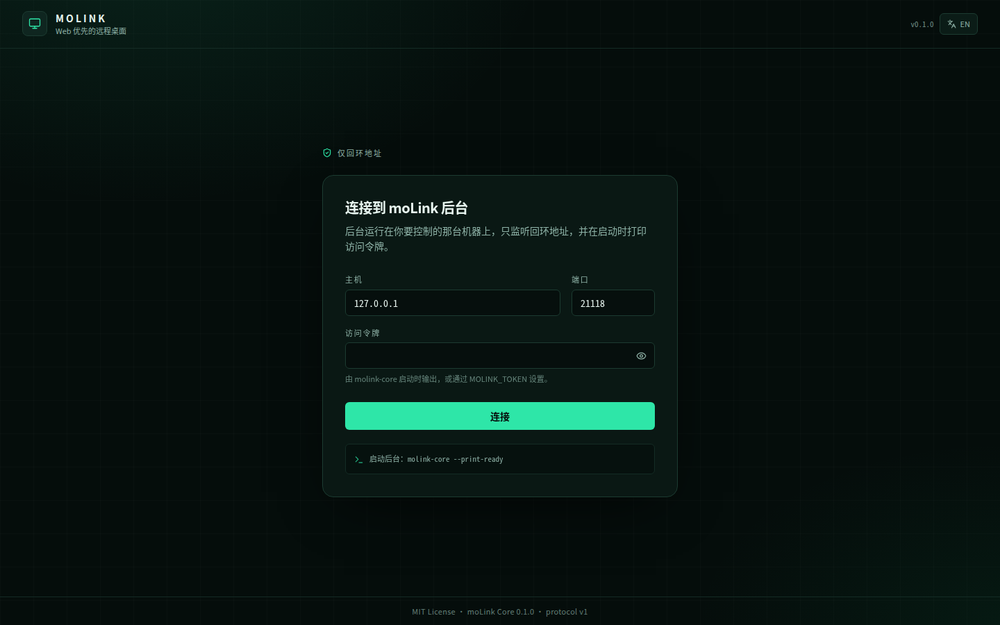
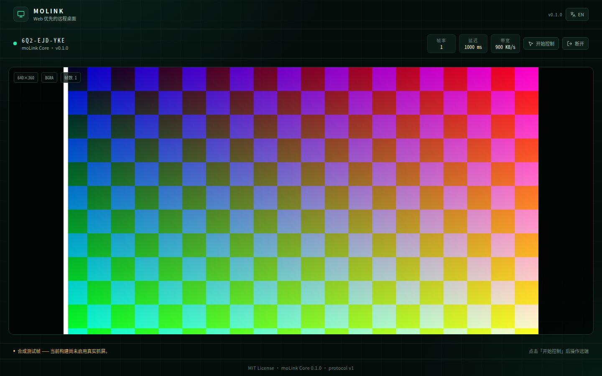

# moLink

跨平台远程桌面。Web 优先，一套后台 + 浏览器壳层，桌面端直连，移动端经服务端中转。

> 版本 0.1.0 · MIT · 协议版本 1




> 会话页截图为合成测试帧演示；接入真实屏幕后画面即为本机桌面。

## 当前状态

一阶段（桌面直连）已经完整实现：Linux（X11）、Windows（DXGI）与 macOS（CoreGraphics）都有各自的抓屏、输入注入、光标与剪贴板后端，三个平台使用系统 WebView 的独立壳层。

| 能力 | 状态 |
|---|---|
| `molink-core` HTTP/WS 后台 | ✅ 可构建、可运行 |
| 令牌鉴权、回环地址约束、CORS | ✅ |
| MOLK 瓦片帧包编解码（C++ + TS 双实现） | ✅ 36 项协议测试通过 |
| WebSocket 会话通道、心跳、空闲回收 | ✅ |
| React 前端（连接页 / 会话页 / 中英双语） | ✅ |
| **Linux 真实抓屏（X11 + XShm）** | ✅ 增量瓦片、XDamage、无会话时暂停 |
| **Linux 输入注入（XTEST）** | ✅ 指针、按键、滚轮、组合键；控制模式需手动开启 |
| **远端光标** | ✅ XFixes 形状 + 位置，客户端覆盖层对齐渲染 |
| **剪贴板同步** | ✅ X11 文本剪贴板，双向，上限 192 KiB |
| **瓦片 zlib 压缩（codec 5）** | ✅ 真实桌面实测 94 → 7.4 Mbps |
| Linux Wayland / PipeWire 门户抓屏 | ⏳ 未实现（接口已抽象） |
| Windows / macOS 捕获与注入 | ⏳ 未实现 |
| UDP 直连、WebRTC、P2P、服务端 | ⏳ 二阶段 |
| **Linux 桌面壳（C++/WebKitGTK）** | ✅ 冒烟通过，`.deb` + `.AppImage` |
| **Windows 桌面壳 + 后端** | 🧩 WebView2 壳与 DXGI/SendInput 后端已实现，MinGW 编译通过 |
| **macOS 桌面壳 + 后端** | 🧩 WKWebView 壳与 CoreGraphics/CGEvent 后端已实现，待 macOS CI 验证 |

## 架构

```
┌──────────────┐        ┌────────────────────────────────┐
│ 桌面壳层     │        │ molink-core (C++/libuvcpp)     │
│ React 前端   │◄──────►│ HTTP/WS 127.0.0.1:21118        │
└──────────────┘        │ 捕获/编码 · 输入注入 · UDP     │
                        └────────────────────────────────┘
```

- **molink-core**：C++20 + libuvcpp 后台。负责 HTTP/WS 接口、瓦片帧编码、会话管理；捕获与注入待接入。
- **frontend/**：React 19 + TypeScript + Vite + Tailwind 4 + Zustand + react-i18next。
- **shell/**：三个平台各自的原生壳层（Linux GTK/WebKitGTK、Windows WebView2、macOS WKWebView），启动并监管 `molink-core`，加载核心托管的前端。
- **server/**、移动端：二阶段。

## 目录

```
molink/
├── .github/workflows/   ci.yml · release-desktop.yml · release-mobile.yml（占位）
├── backend/             molink-core（CMake，libuvcpp）
├── frontend/            React 前端
├── shell/native/        Linux 壳层（GTK3 + WebKitGTK）
├── shell/windows/       Windows 壳层（Win32 + WebView2）
├── shell/macos/         macOS 壳层（Cocoa + WKWebView）
├── packaging/           linux(.deb/.AppImage) · windows(NSIS) · macos(.dmg)
├── docs/
│   ├── dev.md           架构基线与发布策略（需求文档）
│   └── protocol.md      MOLK 线协议与 HTTP/WS 契约
├── LICENSE
└── README.md
```

## 快速开始

前置：CMake ≥ 3.20、C++20 编译器、libuvcpp ≥ 1.7（编译时开启 `UVCPP_BUILD_WEB` 与 `UVCPP_BUILD_WEBAPP`）、Node.js LTS + pnpm。

```bash
# 后台
cmake -S backend -B backend/build -DCMAKE_BUILD_TYPE=Release
cmake --build backend/build
MOLINK_TOKEN=dev-token ./backend/build/molink-core --print-ready

# 前端（另一个终端）
cd frontend && pnpm install && pnpm dev
```

Linux 默认使用 X11/XShm 抓取当前屏幕；在 Wayland 会话或没有显示器的环境里会自动回退到合成测试帧。可显式控制：

```bash
./backend/build/molink-core --capture-fps 15      # 抓屏帧率上限
./backend/build/molink-core --no-capture          # 强制合成测试帧
./backend/build/molink-core --no-input            # 禁止指针/键盘注入
./backend/build/molink-core --no-compress         # 关闭 zlib 瓦片压缩
./backend/build/molink-core --no-clipboard        # 关闭剪贴板同步
MOLINK_DISPLAY=:1 ./backend/build/molink-core     # 指定 X display
```

抓屏只在有已鉴权会话时运行；没有客户端时进程空闲占用接近 0%。

会话页需要点击「开始控制」后才会把指针与键盘事件发送到远端，默认不接管输入。

打开 <http://localhost:1420>，填入令牌连接。也可以直接带参数自动连接：

```
http://localhost:1420/?host=127.0.0.1&port=21118&token=dev-token
```

桌面壳层（Linux，需要 `libgtk-3-dev` 与 `libwebkit2gtk-4.1-dev`）：

```bash
cmake -S shell/native -B shell/native/build -DCMAKE_BUILD_TYPE=Release
cmake --build shell/native/build --parallel
./shell/native/build/moLink
```

生成 Linux 安装包：

```bash
./packaging/linux/build-deb.sh       # build/package/molink_0.1.0_amd64.deb
./packaging/linux/build-appimage.sh  # build/package/moLink-0.1.0-x86_64.AppImage
```

Windows（需 WebView2 SDK 与 NSIS）与 macOS（`.app` + `.dmg`）的构建步骤见
`packaging/windows/` 与 `packaging/macos/`，发布工作流会在对应 runner 上自动完成。

> 本机若出现 `libllhttp.so.9.2: cannot open shared object file`，说明安装的
> `libuvcpp.so` 缺少 `RUNPATH`。本项目的 CMake 已用旧式 `RPATH` 让间接依赖可解析；
> 发布包仍需把 `libuvcpp`、`libllhttp` 等共享库一并打入。

## 测试

```bash
# 协议编解码（不依赖 libuvcpp，CI 也跑这一组）
cmake -S backend -B backend/build -DMOLINK_BUILD_CORE=OFF && cmake --build backend/build
ctest --test-dir backend/build --output-on-failure

# 前端
cd frontend && pnpm lint && pnpm typecheck && pnpm build
```

## 协议

见 [docs/protocol.md](docs/protocol.md)。要点：

- 所有传输共用同一套 **MOLK** 帧包；Magic `"MOLK"` 不可更改。
- 包头 32 字节，帧体 16 字节 + 16 字节/瓦片 + 瓦片字节，全部小端。
- WebSocket 通道上，二进制消息 = 一条完整 MOLK 包，文本消息 = JSON 控制消息。
- 鉴权位于应用层：连接后必须发送 `hello`，令牌错误以 1008 关闭。

## 发布

推送 `v*` 标签触发 GitHub Actions。一阶段只发布桌面三平台安装包（`.exe`/`.msi`、`.AppImage`/`.deb`、`.dmg`），**不上传任何 zip**。服务端与移动端资产属于二阶段。

## 发布状态

版本记录见 [CHANGELOG.md](CHANGELOG.md)，发布前检查项与当前阻塞见
[docs/release-checklist.md](docs/release-checklist.md)。

| 平台 | 产物 | 状态 |
|---|---|---|
| Linux | `.deb`、`.AppImage` | 本机构建并冒烟通过 |
| Windows | NSIS `.exe` | 壳层交叉编译通过，安装器由 CI 构建 |
| macOS | `.dmg` | 壳层源码就绪，由 macOS CI 构建 |

推送 `v*` 标签会触发 `.github/workflows/release-desktop.yml`，三个平台并行构建并把
产物附加到同一个 Release；需要仓库变量 `UVCPP_REPO`（libuvcpp 源码地址）。

## 许可证

MIT。
